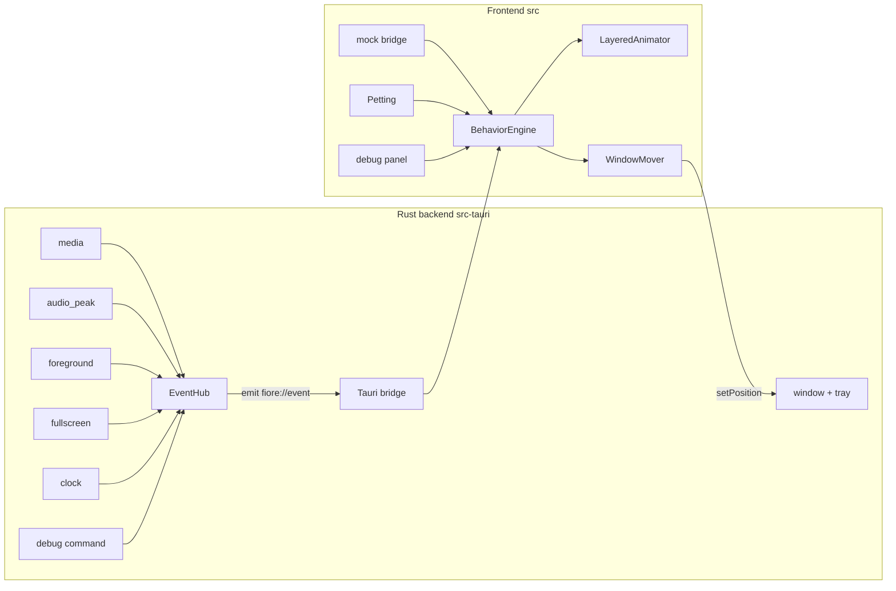

# Architecture

Purpose: components, data flow, threading, window model and error policy. Scope and events live in `docs/fiore-mvp-spec.md`; module paths in `docs/codemap.md`.
last-verified: 2026-11-08

## Components

## Data flow
`Sensor -> Hub -> bridge -> BehaviorEngine -> Animator / WindowMover`

1. A sensor thread observes the OS and sends a `FioreEvent` on an `mpsc` channel.
2. The hub receives, dedupes unchanged state, and emits it on the Tauri event `fiore://event`.
3. The frontend bridge (`src/bridge/`) delivers typed events to the engine. In mock mode the bridge is fake and runs in a browser.
4. Petting runs in the frontend and feeds `pet.*` events straight into the engine (same event type).
5. The engine (pure) maps `(state, event, now, rng)` to a `Resolution`: layer selections (`body`, `face`, `outfit`, `accessory`), speed multiplier, bubble, and window moves.
6. The animator draws the layers from the merged atlas; the mover calls the window position command.

### Wire format
`FioreEvent` is a serde enum, `#[serde(tag = "type", content = "payload", rename_all_fields = "camelCase")]` with `dot.case` type names (`#[serde(rename = "music.started")]`). TypeScript mirror in `src/events.ts` is a discriminated union on `type`. Example: `{"type":"music.level","payload":{"peak":0.42}}`. The full catalog is in the spec.

### Contracts (frozen in W1.0)
`FioreEvent` + TS mirror; `Sensor` trait (`fn name(&self) -> &'static str`, `fn start(&self, tx: Sender<FioreEvent>) -> Result<(), SensorError>`); hub registration (all 5 sensors as stubs); reaction registry (`reactions/index.ts`, one stub per feature); atlas schema + loader (`src/render/atlas.ts`); engine input/output types (`src/behavior/types.ts`); debug command `emit_debug_event`. After W1.0, parallel tasks fill owned files only.

`start` runs on the hub-spawned sensor thread and may block. `Err` or a panic (caught with `catch_unwind`) disables that sensor only. The first report of each state field (activity, mood, season, fullscreen, music) is a baseline: the hub folds it and emits `state.snapshot` instead of the change event. Later state events are forwarded only when the value changes. `music.level` is forwarded only while music is playing. `pet.*` events pass through. The hub emits `state.snapshot` after the sensors are spawned, and again when the frontend invokes `frontend_ready` (the listen-before-setup race in `docs/reference/tauri-v2.md`). A sink failure is logged at `debug` and the event is dropped. Pre-sensor defaults are activity `other`, mood `content`, season `autumn`, fullscreen off, music stopped.

Debug injection (debug builds only) is `emit_debug_event` plus a TCP listener on `127.0.0.1` port `FIORE_DEV_PORT` (default 17321), one JSON `FioreEvent` per line. The hub still emits on the single channel `fiore://event`.

### Engine
Pure function, no I/O. Reactions are per-feature reducers registered in `reactions/index.ts`; the engine composes them by the priority stack in the spec (section 2). Time and randomness are inputs, so golden replay is deterministic.

### Sprites
Atlas per group: `public/sprites/<group>.png` + `.json`; loader merges at startup. All layers share the 32x32 grid and anchor. Reference: `docs/reference/sprite-atlas.md`.

## Threading
- **Main thread:** Tauri runtime, window, tray.
- **One OS thread per sensor**, spawned by the hub. Sensors are independent; a stuck sensor never blocks another.
- **COM/WinRT:** each sensor thread that touches COM/WinRT initializes it itself (MTA) at thread start and uninitializes at exit. COM interface pointers never cross threads; only plain `FioreEvent` values do.
- **Channel:** `std::sync::mpsc` (sensors -> hub). Hub emits on its own thread via the Tauri `AppHandle`.
- **Polling:** foreground 500 ms; fullscreen <= 500 ms (or notification-driven); audio peak ~15 Hz and only while music is playing; clock 60 s plus a midnight check. Sleeping threads use `recv_timeout`/`park_timeout` so shutdown is prompt.
- Frontend is single-threaded; the engine runs synchronously per event/tick.

## Window model
- One transparent, frameless, always-on-top window, skip-taskbar, not resizable, sized to the pet (96x96 plus bubble margin).
- Single instance (second launch focuses/does nothing). Tray: Show/Hide, Autostart toggle (P3), Quit.
- Movement via `setPosition` from `WindowMover`; the sprite region receives pointer input.
- Fullscreen: the window is hidden (not closed); sensors keep running (spec 3.1).

## Error-handling policy
- Rust: typed errors with `thiserror`; no `unwrap` outside tests (`docs/conventions.md`).
- **Sensor failure:** log with `tracing` (`warn`/`error`), disable that sensor, keep the hub and other sensors running. Never panic; never crash the app. Transient read errors retry with capped backoff before disabling.
- Hub send failure (no frontend yet) drops the event and logs at `debug`; the next `state.snapshot` re-syncs.
- Frontend: an unknown event type or malformed payload is logged and ignored; the engine never throws on input.
- Missing sprite group or animation: log once, fall back to `idle` of `base`.

## Logging and diagnostics
`tracing` JSON lines to `logs/fiore-dev.log` (gitignored). Window titles and track names appear only at `debug`. `dev:mock` runs the UI in a browser; `emit-event.mjs` injects events into a running dev app.

## Privacy
Only counts/state are observed: pointer position, foreground process/title, media session metadata, audio peak, clock. Keystroke content is never read.
